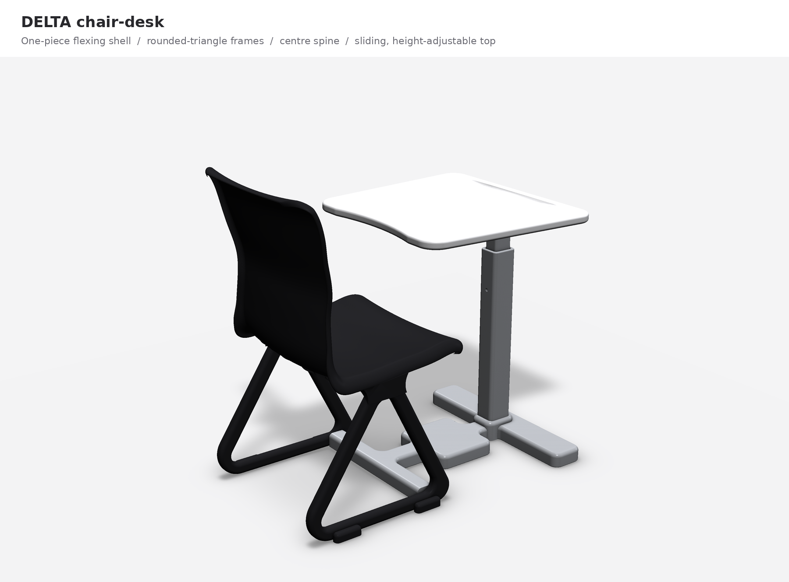
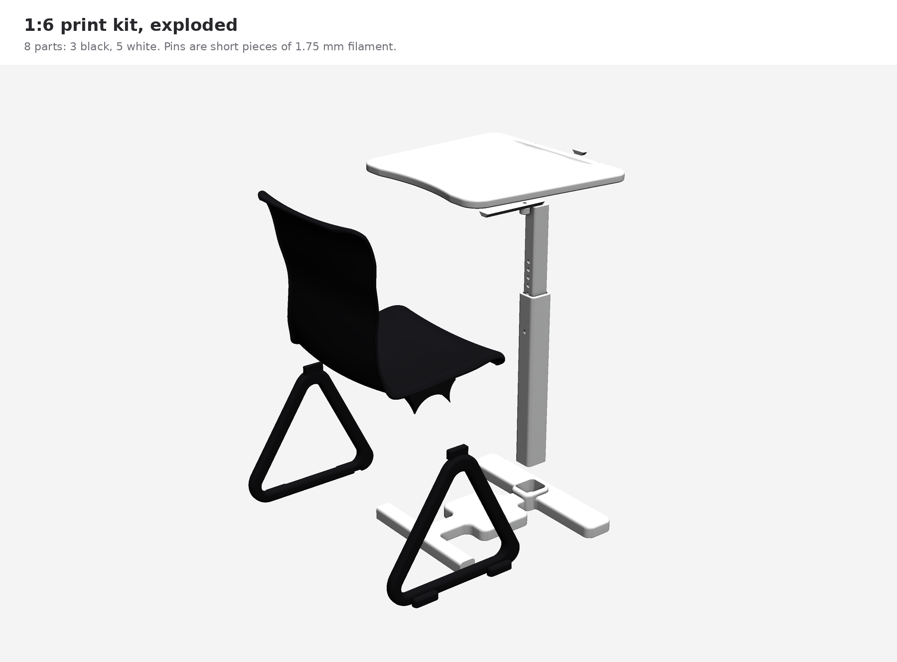
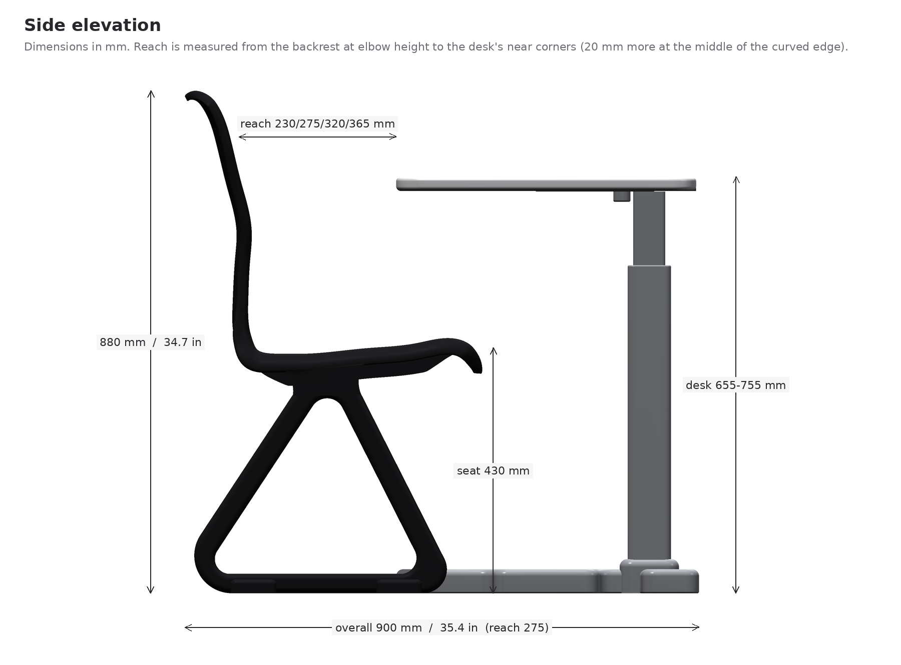
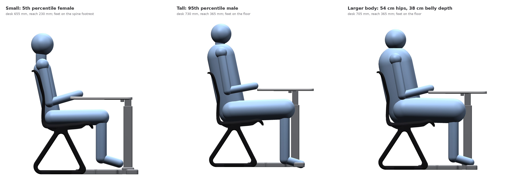
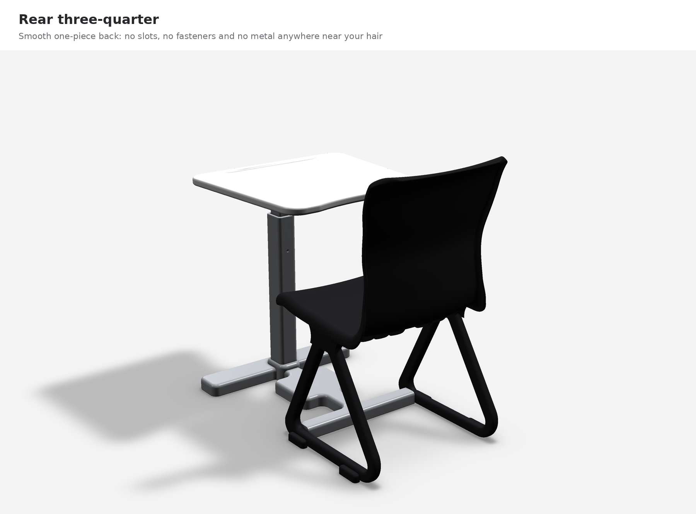
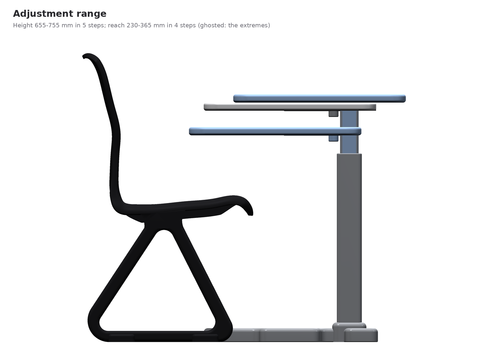
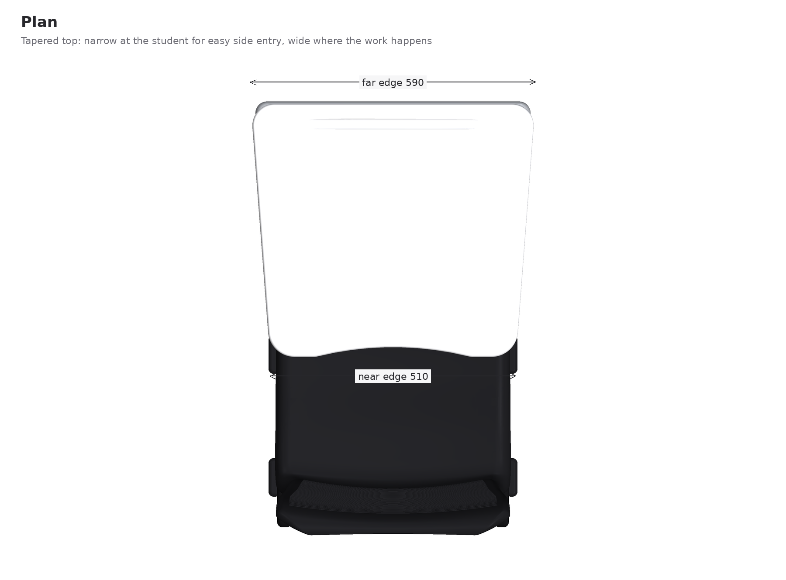
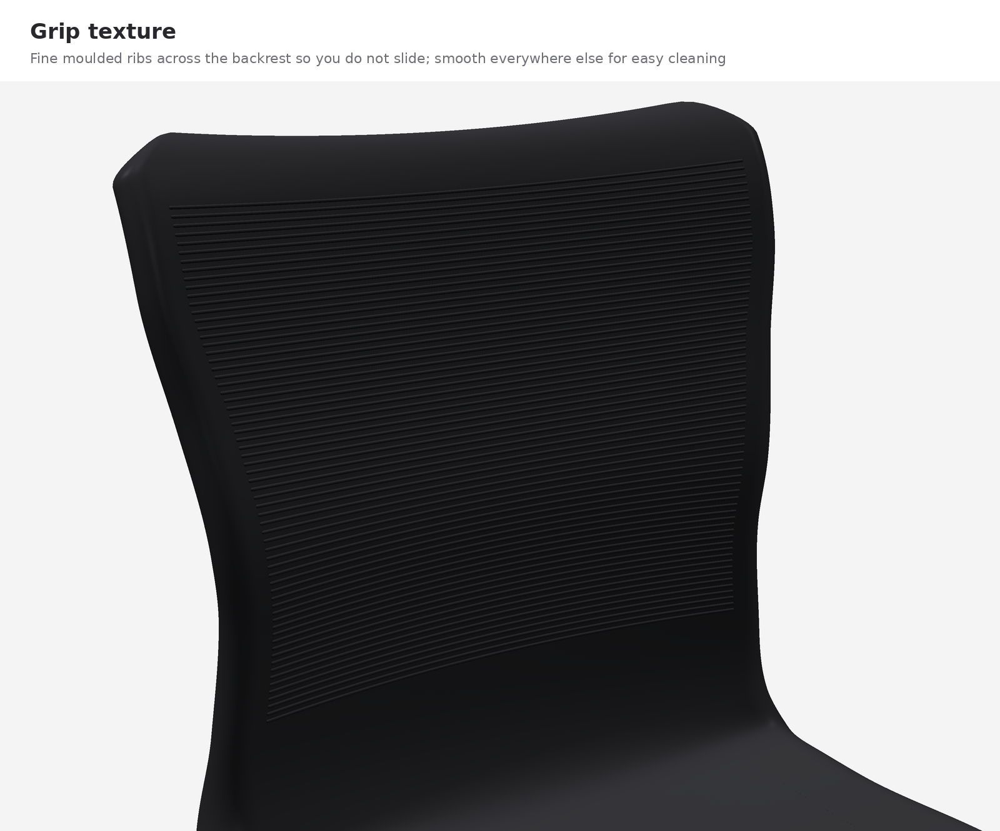

# DELTA: a school chair-desk, redesigned



A redesign of the Virco chair-desk used in our classrooms, which is most likely the Virco 3700BRM: navy hard plastic, chrome tubes, a tablet top on a single side arm and a wire basket under the seat. DELTA keeps what the old desk does well (one piece, hard to break, easy to wipe) and fixes what it does badly.

- **The back flexes.** The seat and back are one moulded polypropylene shell. The back gives about 3.5 degrees when you lean and about 6 when you lean hard, then springs back. There is a fine grip texture where your back touches it.
- **Nothing catches hair.** No separate backrest, no chrome tubes behind your head, no screws in the back, no gaps.
- **No side bar.** The only connection between chair and desk is a low bar on the floor down the middle, so you can turn to either side, and it works the same for left-handers. The desktop can't twist or come off.
- **It fits short, tall and bigger students.** The desktop moves up and down (5 heights, 25.8 to 29.7 in) and toward or away from you (4 reach settings). The centre bar doubles as a footrest for shorter students, and the seat is 18.9 in wide with open sides.
- **More desk.** The top is about 11% bigger than the old one and all of it is in front of you. It's narrower at your end so it's easy to slide in from the side. A pencil groove sits along the far edge, and there's no raised lip. The trade-off: the whole desk takes more floor than the old tablet-arm one (see [`docs/DESIGN.md`](docs/DESIGN.md#size-in-the-classroom)).
- **Two rounded triangles** hold up the seat, with the back corner rounded off. Every edge on the desk is rounded.
- **Black, white and grey,** and mostly plastic.

## The files

| what | file |
|---|---|
| 3D print, black parts | [`print/DELTA_1-6_BLACK_plate.3mf`](print/DELTA_1-6_BLACK_plate.3mf) |
| 3D print, white parts | [`print/DELTA_1-6_WHITE_plate.3mf`](print/DELTA_1-6_WHITE_plate.3mf) |
| Single parts (STL, ready to print) | [`print/stl/`](print/stl/) |
| How to print and build it | [`docs/PRINT_GUIDE.md`](docs/PRINT_GUIDE.md) |
| See it full size in your room (iPhone/iPad AR) | [`models/DELTA_chair-desk_AR.usdz`](models/DELTA_chair-desk_AR.usdz) |
| Full-size model for any 3D viewer | [`models/DELTA_chair-desk_full-size.glb`](models/DELTA_chair-desk_full-size.glb) |
| Full-size model for CAD (Fusion, Onshape, SolidWorks); exact surfaces, without the grip texture and seat ribs | [`models/DELTA_chair-desk_full-size.step`](models/DELTA_chair-desk_full-size.step) |
| Full-size model for SketchUp (File > Import, COLLADA) | [`models/DELTA_chair-desk_for-SketchUp.dae`](models/DELTA_chair-desk_for-SketchUp.dae) |
| Why every part is the way it is | [`docs/DESIGN.md`](docs/DESIGN.md) |
| Research: the Virco desk, body sizes, standards | [`docs/RESEARCH.md`](docs/RESEARCH.md) |
| Checks: fit, printability, tipping, strength | [`docs/VERIFICATION.md`](docs/VERIFICATION.md) |
| Pictures | [`renders/`](renders/) |

To see it in AR, open the `.usdz` file on an iPhone or iPad (from Files, AirDrop or Messages). Quick Look opens it; tap "AR" and put it on the floor. It's real size.

To open it in SketchUp, use File > Import and pick the `.dae` file; it comes in at real size with each part as its own coloured group. If your version of SketchUp doesn't offer COLLADA, import the STL files in `models/stl/` instead and choose millimetres when it asks for units.

## The print



The 1:6 model is 8 parts: 3 in black PLA and 5 in white. Everything prints without slicer supports and snaps together, and the two pins are short pieces of 1.75 mm filament. The back really flexes, the desktop slides and the post changes height. See [`docs/PRINT_GUIDE.md`](docs/PRINT_GUIDE.md).

## Pictures

| | |
|---|---|
|  |  |
|  |  |
|  |  |

## Rebuilding it

Everything is generated from one set of numbers in [`cad/deskgen/params.py`](cad/deskgen/params.py). Change a dimension there and rebuild:

```
pip install cadquery trimesh manifold3d mapbox_earcut fast-simplification usd-core pycollada scipy shapely rtree vtk
python cad/build.py            # print files + full-size models (about 1 minute)
python cad/build.py --step     # also the STEP file (about 6 more minutes)
python cad/verify_all.py       # rewrites docs/VERIFICATION.md
python cad/render_all.py       # rewrites the pictures
```
