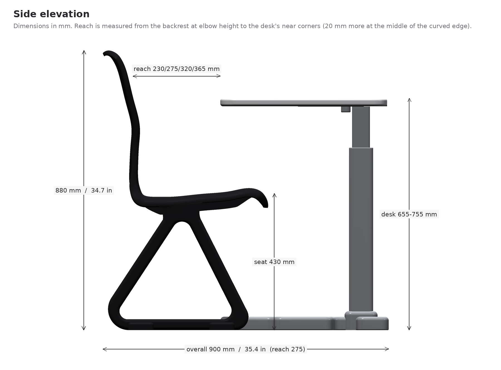
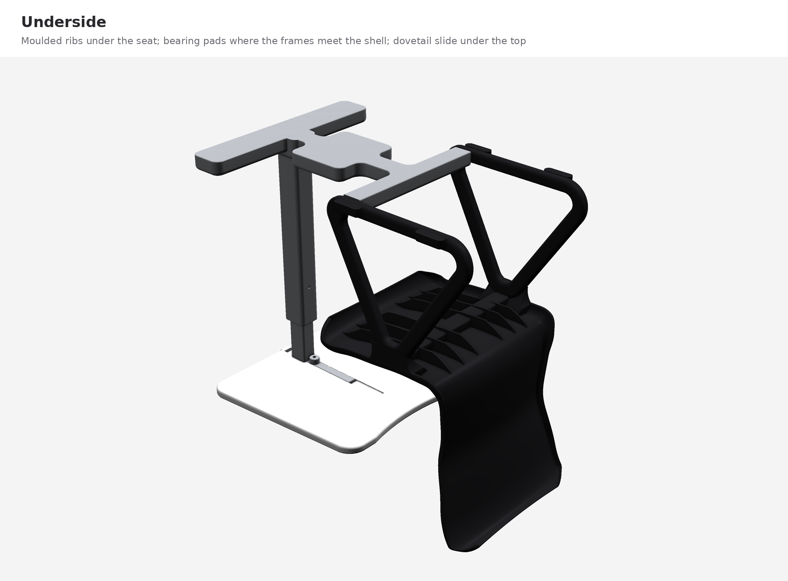
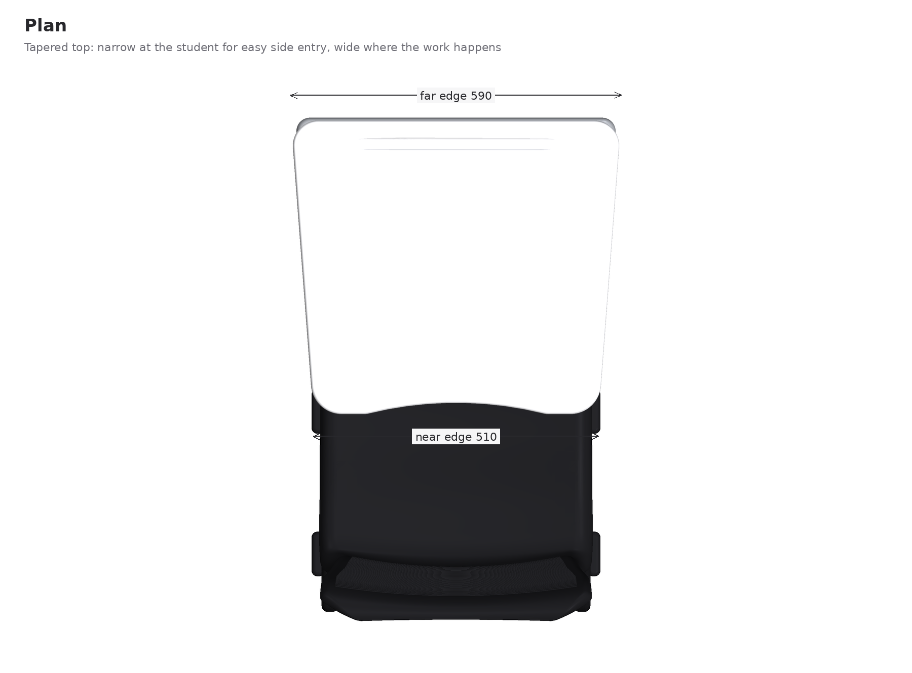

# DELTA chair-desk: design notes

## The desk we have now

Our classrooms use a Virco tablet-arm chair desk, most likely the **3700BRM** (3000 Series). It's built from navy hard plastic and chrome steel tube:

- a seat and a *separate* backrest, held apart by chrome tubes
- one chrome arm up the right side, holding a paddle-shaped top listed as 20 in wide and 14.5 to 28 in deep
- a wire book rack under the seat
- 18 in seat height; listed overall size 18.75 x 31 x 30.5 in; 35 to 45 lb; rated around 250 lb

It was designed to be cheap, tough and easy to wipe, and it is all three. It's also where these complaints come from:

| complaint | cause | what DELTA does |
|---|---|---|
| Uncomfortable for taller students | fixed 18 in seat, fixed desk height, fixed distance to the desk, knees hit the arm and rack | desk height (5 steps) and reach (4 steps) adjust; open space under the desk; slim centre post |
| Hard on your back | hard flat back, held rigidly on tubes | one-piece shell with a lumbar curve about 23 cm above the seat that gives about 3.5 degrees when you lean and about 6 when you lean hard |
| Slippery back | smooth hard plastic | fine moulded ribs across the backrest |
| Hair gets caught | gaps between the backrest and the chrome tubes behind your head | no separate back, no tubes, no fasteners, no gaps anywhere near your head |
| Book rack nobody uses | a small wire basket | removed; the open bay between the frames holds a bag off the aisle |
| Side bar blocks turning | the single arm is on one side | the only connection is a low bar on the floor down the middle; both sides are open |
| Not enough desk | a paddle top, part of which is beside you | a top about 11 % larger, all of it in front of you |
| Pencil groove | useful, keep it | kept, with ramped ends so crumbs wipe out |

## How DELTA is put together

### Seat shell

The seat and back are one polypropylene moulding, like the best stacking chairs, so there is no joint to trap hair and nothing to come loose. Its side profile does the ergonomic work:

- The seat is 480 mm (18.9 in) wide and about 400 mm (15.7 in) deep. That depth stays under 95 % of the thigh length of a small student, so the front edge never presses behind her knees.
- The seat tilts back about 4.5 degrees. The lower back sits at about 104 degrees to the seat and the upper back at about 109. EN 1729 (the European school furniture standard) allows 95 to 110. That's reclined enough to take weight off your spine and upright enough to keep you over your work.
- The lumbar curve peaks about 227 mm above the seat, inside the band measured for US adults (Dowell 1995: average about 25 cm, range 15 to 36 cm).
- The back reaches about 450 mm above the seat and ends in a rolled lip, which is also the handle for moving the desk.
- The front edge rolls down in a waterfall so it doesn't dig into the backs of your legs.
- The seat edges roll down on both sides. That's what makes sitting sideways comfortable when you turn to talk to someone.

**Why it flexes, and why it doesn't flex too much.** The first version of the shell had a narrow, flat waist meant to act like a hinge. The beam model in `cad/deskgen/analysis.py` showed that was badly wrong: under a normal lean it would have folded 44 degrees and overstrained the plastic. Flex only stays in the safe range if the bending is spread over most of the back. So the lower and middle back curve around your body evenly (about 24 mm of wrap across the width) and bend together over roughly 300 mm, like a carpenter's tape measure. The wall is 6 to 6.5 mm through that zone, and the seat-to-back corner thickens to 9.5 mm. On the real product the thick corner would be cored out with gas-assist moulding so it doesn't sink, and it stays smooth on the outside. Under the seat, three pairs of moulded ribs carry the load to the frames. The result: about 3.5 degrees for a casual lean (150 N) and about 6 degrees for a firm one (250 N), and back again when you sit up. Numbers are in `VERIFICATION.md`.

**Grip.** Fine ribs, about 1 mm high and 5 mm apart on the real chair, run across the backrest where your back touches it. On the 1:6 model they're scaled up so you can feel them. The seat stays smooth so it's easy to slide in and out and to clean.

**Hourglass back.** The back narrows to about 416 mm at the waist and widens to 480 at the shoulders. The narrow waist leaves room for your arms when you turn, and it's where the back flexes most.

### Side frames

Two rounded triangles, one under each side of the seat, as drawn. Each is a closed ring with a triangular window through the middle. The rear bottom corner is replaced by a large round (the "cut-off" corner from the sketch), so the back of the frame reads as a heel rather than a spike and nothing catches a shoe. I kept that corner, but closed: a closed triangle is what makes the frame stiff, and an open one would have to be much thicker to carry the same weight.

The frames sit flush with the sides of the seat, which puts the support right under where you sit when you perch on the edge. Their tops nest into moulded pads under the seat that flow into the shell like a fillet, and the seat bolts to them from underneath. A hidden aluminium beam (50 x 25 mm) runs across under the seat between the two frame tops. It carries the middle of the seat and ties the frames together so they can't spread under a heavy student.

At each foot a low glide pod stands 18 mm out from the frame. The pods widen the footprint to 516 mm at the seat, which is what keeps the chair from tipping when someone leans out sideways to get a bag.

In production the frames would be gas-assist moulded glass-filled nylon (PA6-GF30), the same material as an office chair base: black, hollow inside, very strong and cheap in volume. Each frame carries its load mostly in compression along the legs, which is the reason a triangle is the right shape here.

### Floor base and the "no side bar" problem

The chair and desk connect only through one low, grey "I" on the floor: a cross bar between the fronts of the two frames, a spine down the centreline with a wider footrest pad on it, and a T-foot under the far end of the desk. The frames bolt to the square ends of the cross bar.

- **Turning.** With nothing at seat height on either side, you can swing your legs out to the left or the right. Left- and right-handed students get the same desk.
- **Trip hazard.** The base is 42 mm (1.7 in) tall with fully rounded edges, about the height of a sled chair's runner. Nothing on the floor is wider than the desktop above it. At the nearest reach setting the T-foot shows 5 cm past the desk's far edge; at the second it's flush, and at the other two it's tucked under.
- **Footrest.** The footrest pad sits right where a shorter student's feet land. For a 5th percentile girl the seat is about 55 mm higher than her knees; resting her feet on the pad cuts that to about 13 mm. Taller students don't notice it, because it's between their feet.
- **Stability.** The T-foot is 570 mm wide, and its front edge sits close to the desk's far edge, so someone sitting on the far corner of an empty desk can't tip it over at the three nearer settings. At the farthest setting it takes 127 kg on that corner (see the tipping table in `VERIFICATION.md`).

### Post and head

A telescoping aluminium post at the centre of the far end holds the desk. The upper tube slides in the lower one, and a pin running front to back, with its knob on the far side where it's hard to fiddle with from the seat, locks it at five heights 25 mm (1 in) apart: 655, 680, 705, 730 and 755 mm (25.8 to 29.7 in). That's the same push-pin system most adjustable school desks already use, so custodians know it. The lower tube is tall enough that the unused holes stay hidden inside it. If someone pulls the pin, the upper tube bottoms out inside the lower one at the lowest setting instead of dropping further.

On top, a dovetail runs back toward the student under the desktop. The desktop slides along it to four reach settings, 45 mm apart, and an index pin underneath holds it. The dovetail means the desktop can't twist or lift off, and an end cap pressed into the far end of the track means it can't slide off either, so the desk can't turn or come loose even if the pin is out. On a real desk the index pin would be a spring plunger with a pull tab under the near edge.

The post is 66 mm wide at knee height, so tall students' knees sit either side of it. Every gap around the post that a hand can reach stays wider than 25 mm, even at the lowest setting, so nothing can pinch fingers.

### Desktop

- 590 mm (23.2 in) wide at the far edge, 510 mm (20.1 in) at your end, 525 mm (20.7 in) deep, 25 mm thick. That's about 438 sq in of outline against roughly 395 for the old paddle top (the paddle is 20 x 14.5-28 in before its rounded corners and body cut-out), so about 11 % more, and all of it is in front of you.
- The near edge curves in by 20 mm across the middle, so there's room for your body without pushing the whole desk away.
- The top is tapered, narrower at your end, so there's more room to swing your legs in from the side.
- The pencil groove runs 380 mm along the far edge, 22 mm wide and 6 mm deep, with long ramped ends instead of walls so crumbs and eraser dust wipe straight out.
- **No raised lip.** A lip at the far edge would stop pencils rolling off, but the groove already does that. A lip also catches crumbs when you wipe the desk, gets in the way of a laptop, and a raised edge is another thing to chip. So the surface stays flush and the groove does the job.
- In production it's a seamless moulded hard-plastic top in white, like Virco's own hard-plastic tops. A laminate top with glued edge banding is cheaper, but students pick at edge banding until it peels off.

### Storage

The wire basket is gone. Between the two frames there's an open bay under the seat, 420 mm wide. It takes a Chromebook, a binder, books, lunch or a small backpack, and keeps them out of the aisle. You can reach it from behind or through either frame's window. A full-size backpack is too big for any space under a chair seat, this one included; it will stick out behind the seat, which still keeps it off the aisle. A bigger basket would take room from your heels and legs, which matters more.

## Main dimensions

| | mm | in |
|---|---|---|
| Seat height (front edge) | 430 | 16.9 |
| Seat width / depth | 480 / 400 | 18.9 / 15.7 |
| Back top above seat | 450 | 17.7 |
| Desk height | 655 to 755, 5 steps | 25.8 to 29.7 |
| Backrest to desk corners (add 20 at the middle) | 230 / 275 / 320 / 365 | 9.1 / 10.8 / 12.6 / 14.4 |
| Desktop | 590 far x 510 near x 525 deep x 25 | 23.2 x 20.1 x 20.7 x 1.0 |
| Overall width | 590 (desk), 570 (floor) | 23.2, 22.4 |
| Overall length | 900 / 900 / 940 / 985 by reach setting | 35.4 / 35.4 / 37.0 / 38.8 |
| Overall height | 880 | 34.7 |
| Weight (estimate) | about 18 kg | about 40 lb |

The seat height is 430 mm rather than Virco's 457 on purpose. School-furniture research says to size seats by the height of the back of the knee (popliteal height), and that a seat that is too high is worse than one that is too low, because it presses on the underside of the thighs. At 457 mm the old desk is about 8 cm too high for the smallest high-schoolers and about 4.5 cm too high for an average girl. 430 mm is EN 1729 size 5, and the adjustable desk makes up the rest for taller students.

## Size in the classroom

| | Virco 3700BRM (listed) | DELTA |
|---|---|---|
| Width | 18.75 in | 23.2 in (desk), 22.4 in (floor) |
| Length | 31 in | 35.4 in at the two nearest reach settings |
| Desk area | about 395 sq in, partly beside you | about 438 sq in, all in front |

This is the one place DELTA doesn't do what you asked. It takes more floor than the tablet-arm desk: against Virco's listed size, about 4.4 in more length and a bit over 4 in more width, or roughly 40 % more floor in a rectangle drawn around each desk. The listed width can't include the whole 20 in tablet, so the real difference is smaller than that, but it isn't zero.

Most of it comes from putting the whole desktop in front of you. The old desk saves room by hanging its small tablet beside you and over your lap; a bigger desk that's all in front has to reach further forward. Two things claw some of that back. You get in from either side, so rows don't need the extra clearance a one-sided desk needs on its open side. And the next row's desk tucks right up behind your chair, because the back of the chair is just a shell and a low heel.

If keeping the old footprint matters more than the bigger desk, every dimension is in `cad/deskgen/params.py`. A narrower desktop and T-foot would bring the width down, at the cost of desk area and some sideways stability, and `cad/verify_all.py` re-checks the tipping after any change.

## Materials

| part | real product | colour |
|---|---|---|
| Seat shell | polypropylene impact copolymer, 5 mm wall (6-9.5 mm at the back's bend), moulded grip texture; talc- or glass-filled in the junction if FEA calls for it | black |
| Side frames | glass-filled nylon (PA6-GF30), gas-assist moulded (hollow) | black |
| Seat beam | aluminium tube, hidden under the seat | black |
| Floor base | cored aluminium casting, powder coated | light grey |
| Post and head | aluminium extrusions and a cast head, powder coated | light grey |
| Desktop and track end cap | seamless moulded hard plastic | white |
| Glide pods | nylon; felt versions for wood floors | black |

Almost everything you see or touch is plastic. The metal is in the post, the base and the hidden beam, where it carries the desk and the student. Polypropylene and nylon are both recyclable (resin codes 5 and 7), and the parts come apart with a few bolts.

## Edge cases considered

- **Left-handers** (about 1 in 10 students): the desk is centred and symmetric, so there's no left- or right-hand version to order.
- **Short students:** lowest desk (25.8 in), nearest reach, feet on the footrest pad. Checked against the 5th percentile female, see the fit picture.
- **Tall students:** highest settings and farthest reach; legs go forward either side of the post; no bar or basket in front of the shins. Checked against the 95th percentile male.
- **Larger-bodied students:** checked against 54.5 cm hips and a 38 cm belly depth. No side bar and no arms, so hips can spread past the seat, whose edges roll down so nothing digs in. The farthest reach gives 385 mm at the middle of the desk edge. That's 2.5 cm short of the check's target (belly depth plus 3 cm of room), and the flexing back makes up part of it; it's the tightest fit in the table. Tipping checks go up to a 400 lb (181 kg) user (`VERIFICATION.md`). A wider-seat version would be the next step for students who need it.
- **Leaning back hard:** the rear feet sit under the back of the seat, and the rear tipping check passes with nearly twice the BIFMA-style load.
- **Leaning out sideways** to pick up a bag: passes for students up to 181 kg with their whole weight on the chair, thanks to the glide pods.
- **Pushing down on the back of an empty chair:** it takes 169 kg on the top of the backrest to tip it.
- **Sitting on the desk:** at the three nearer settings you can't tip it by sitting on the far corner; at the farthest it takes 127 kg.
- **Fingers and hair:** no gaps between 8 and 25 mm in reach of a hand, and nothing opens and closes near the head. The pins are solid, the telescoping post only moves when you pull its pin, and the track's open end is capped.
- **Mopping and sweeping:** the floor parts are low, rounded and closed, with nothing to wrap a mop around; there's no basket collecting trash.
- **Uneven floors:** the glides on the T-foot can be levelling glides.
- **Vandalism and wear:** no edge banding to pick at, no exposed screws, colour goes all the way through the plastic, and black hides scuffs.
- **Moving desks around the room:** grab the rolled lip on the back and the far edge of the desk.
- **Wheelchair users:** no fixed chair-desk works for them; a separate adjustable table is still needed.

## What isn't solved yet

- The strength numbers are hand calculations. A real product would need FEA and then physical BIFMA X6.1 testing, especially of the seat-to-back junction under the 225 lbf back test, where the simple estimate says unfilled polypropylene isn't enough.
- DELTA takes more floor than the tablet-arm desk (see "Size in the classroom").
- Body-size data for US teenagers is old. I used US Army adult data as the stand-in (see `RESEARCH.md`); the new YouthShape.US survey should replace it when it's published.
- A mixed classroom still spans more sizes than one seat height covers perfectly. The footrest closes most of the gap for short students; ordering two frame heights (for younger and older grades) would close the rest.
- The model's back is PLA, which is stiffer and more brittle than polypropylene, so it only hints at how the real back feels.
